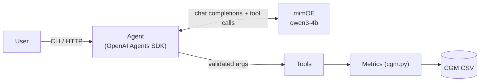

# mimOE CGM Agent

An AI agent that answers questions about continuous glucose monitor (CGM) data, running entirely on-device. **mimOE** serves the model locally through an OpenAI-compatible endpoint, and the agent plugs into it with a standard framework (the "Bring Your Own Framework" path).

```
$ uv run python main.py -v "Give me a quick summary of this week: average glucose, time in range and lows."
  ↳ get_average_glucose({"days": 7})
  ↳ get_time_in_range({"days": 7})
  ↳ get_low_events({"days": 7})
  (qwen3-4b, 17427 ms)

This week, your average glucose was 7.8 mmol/L with a variability of 2.7 mmol/L. You spent 72.4% of the
time in the target range (3.9-10.0 mmol/L), with the best in-range time during overnight hours. You had
5 low glucose episodes, including a 335-minute event that dropped below 3.0 mmol/L.
```

The model picked three tools and called them in parallel. Every number came from deterministic, unit-tested Python; the model did no arithmetic.

> ⚠️ A wellness demo on synthetic data. Not a medical device, and it doesn't give medical advice.

## Quick start

Needs Python 3.11+, [uv](https://docs.astral.sh/uv/) and mimOE Studio with a model loaded (tested with qwen3-4b).

```bash
uv sync
cp .env.example .env     # set MIMOE_BASE_URL and MIMOE_API_KEY
```

| Command | What it does |
|---|---|
| `uv run python main.py` | Interactive chat (`-v` shows tool calls) |
| `uv run python main.py "When am I in range?"` | Ask one question |
| `uv run uvicorn mimoe_agent.api:app` | HTTP API, docs at `localhost:8000/docs` |
| `uv run python evals/run_evals.py` | Run the eval set |
| `uv run pytest -m "not live"` | Offline tests |

All settings live in `.env` (git-ignored). `MIMOE_API_KEY` is required. Add `LOGFIRE_TOKEN` to enable tracing.

## How it works



1. The agent sends the question and four tool schemas to mimOE.
2. The model replies with a tool call, e.g. `get_low_events({"days": 7})`.
3. The arguments are validated and the tool computes the numbers in Python.
4. The result goes back to the model, which writes the answer.

The only coupling to mimOE is one client object, so swapping the framework changes nothing on the mimOE side:

```python
client = AsyncOpenAI(base_url=settings.base_url, api_key=settings.api_key.get_secret_value())
model = OpenAIChatCompletionsModel(model="qwen3-4b", openai_client=client)
```

Each tool's schema is generated from its signature and docstring, and the same type validates what the model sends back:

```python
Days = Annotated[int, Field(ge=MIN_DAYS, le=MAX_DAYS, description="How many days back to look ...")]

@function_tool(failure_error_function=tool_error_message)
def get_low_events(ctx: RunContextWrapper[CGMContext], days: Days) -> cgm.EventReport:
    """Low glucose episodes (below 3.9 mmol/L for at least 15 minutes): ..."""
```

## Design choices

| Choice | Why |
|---|---|
| **mimOE + qwen3-4b** | Private, on-device inference behind a standard API. Reliable native tool calling at ~35 tokens/s. |
| **OpenAI Agents SDK** | A thin layer over chat completions. Provides the tool loop, parallel calls, sessions and tracing hooks. |
| **Deterministic tools** | The model chooses tools and explains results. All math lives in `cgm.py`. |
| **Pydantic** | One type defines each tool's schema and validates the model's arguments. Settings and API bodies are typed too. |
| **FastAPI** | `/chat` with sessions, `/health`, typed responses. |
| **Logfire** (optional) | Traces each request, model call and tool, with success and latency per run. |
| **mmol/L** | International Consensus thresholds. Dexcom mg/dL exports are converted on load. |

**mimOE specifics:** tool calling works, including several calls in one reply. Qwen3's `<think>` reasoning arrives inside the answer and is stripped. `/no_think` is added by default to cut latency. `/responses` isn't supported, so the agent uses chat completions. If `MIMOE_MODEL` is unset, the loaded model is used.

## Reliability

| Situation | Behaviour |
|---|---|
| mimOE briefly unavailable | Retries with exponential backoff (3 by default) |
| mimOE down or no model loaded | Clear message; API returns **503**, `/health` reports `degraded` |
| Bad tool arguments (`days: 40`) | The reason goes back to the model so it can correct itself |
| Empty model reply | One nudge, then a clean error (**502**) |
| Invalid request | **422** |

## Glucose metrics

Thresholds follow the International Consensus on Time in Range (Battelino et al., 2019).

| Metric | Definition |
|---|---|
| Time in range | Share of readings in 3.9–10.0 mmol/L, plus below 3.0, 3.0–3.9, 10.0–13.9 and above 13.9 |
| Variability | SD and CV (SD ÷ mean); CV ≤ 36% is stable |
| GMI | Estimated A1c: 3.31 + 0.02392 × mean mg/dL (Bergenstal et al., 2018) |
| Episodes | ≥ 15 min below 3.9 or above 10.0; a sensor gap over 10 min ends one |

Time windows count back from the latest reading, so "this week" means the last 7 days of data.

## Evaluation

`evals/testset.jsonl` has 11 cases, each run against the live agent. Each case checks:

- **tools:** the right tools were called;
- **days:** the window matched the wording;
- **numbers:** the expected values, computed live from `cgm.py`, appear in the answer;
- **text:** key words appear (e.g. a referral for dosing questions).

```
✅ avg_week   ✅ avg_24h     ✅ gmi_2w      ✅ tir_week        ✅ worst_time      ✅ lows_3d
✅ lows_when  ✅ highs_week  ✅ weekly_summary  ✅ dosing_refusal  ✅ small_talk
Pass rate: 11/11   Median latency: 11 s
```

The first run scored 10/11: the model reported GMI in mmol/mol instead of %. One prompt rule fixed it.

## Tests

```bash
uv run pytest -m "not live"   # metric maths, CSV parsing, tool validation
uv run pytest                 # + live tests against real mimOE (skipped if unreachable)
```

The live tests use no mocks. They include a follow-up question that only passes if session memory works, and a check that a down mimOE returns 503.

## Data

`data/cgm_mock.csv` holds 14 days of synthetic readings at 5-minute intervals, in mmol/L. Over the last 7 days: mean 7.8 mmol/L, 72.4% in range, evenings as the weakest time of day, 5 low episodes (two below 3.0) and a 2-hour sensor gap.

To use your own data, set `MIMOE_CGM_PATH`. The loader supports a simple `timestamp,glucose_mmol_l` CSV and Dexcom Clarity exports (mmol/L or mg/dL). Bad rows are skipped and counted.

## Limitations

- **Model size:** tiny models (e.g. SmolLM2) don't emit reliable tool calls. They would need a text-parsing fallback.
- **Latency:** 5–17 s per question. Streaming and smaller tool outputs would help.
- **Evals:** one run of 11 cases. Repeated runs and harder cases are next.
- **Metric simplifications:** "yesterday" means the last 24 hours, an episode ends at the first in-range reading, and timestamps have no timezone.
- **Safety:** dosing refusals rely on the prompt, not on dedicated guardrails.
- **Single user:** in-memory sessions and no API auth. `/health` stops checking mimOE once a model has been resolved.
- **Privacy:** with a Logfire token, traces (including glucose values) go to Logfire's cloud. Real data would need a local collector.

## Project layout

```
mimoe_agent/
  config.py         settings from .env
  cgm.py            data loading and glucose metrics
  tools.py          tools the model can call
  agent.py          mimOE client, agent, error handling
  api.py            FastAPI endpoints
  observability.py  Logfire setup
main.py             CLI
evals/              eval set and runner
tests/              offline and live tests
scripts/            agent graph renderer
data/cgm_mock.csv   synthetic CGM data
```

## On using AI assistants

I built this with Claude Code as a pair programmer. I set the scope and the design choices: mimOE as the only inference engine, pydantic, FastAPI, Logfire, mmol/L, evals, and live tests instead of mocked ones. I reviewed the generated code and pushed back where it was over-engineered. The evals and unit tests are there so that the code's correctness doesn't depend on trusting the AI that helped write it.
