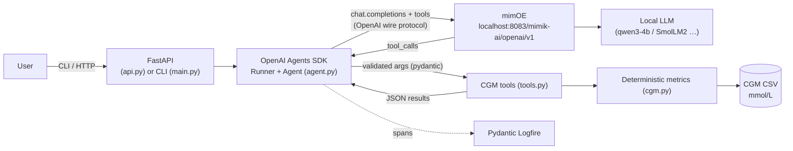
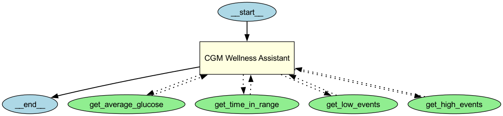

# mimOE CGM Agent

This is a small AI agent that answers questions about your continuous glucose monitor (CGM) data. It runs entirely on your own machine: the model is served locally by **mimOE**, and the agent connects to it through mimOE's OpenAI-compatible endpoint (the "Bring Your Own Framework" path).

```
$ uv run python main.py -v "Give me a quick summary of this week: average glucose, time in range and lows."
  ↳ get_average_glucose({"days": 7})
  ↳ get_time_in_range({"days": 7})
  ↳ get_low_events({"days": 7})
  (qwen3-4b, 16486 ms)

This week, your average glucose was 6.9 mmol/L with a variability of 1.5 mmol/L. You spent 95.2% of the
time in the target range (3.9-10.0 mmol/L), with the best in-range period in the morning and worst in the
evening. You had 4 low glucose episodes, mostly overnight, with the longest lasting 90 minutes.
```

The three tools in that example were called **in parallel, in a single model step**. Every number in the answer was computed by deterministic Python code, not by the LLM.

> ⚠️ This is a wellness demo on synthetic data, not a medical device, and it doesn't give medical advice.

---

## How the components connect



1. **mimOE is the inference engine.** mimOE Studio loads a model and exposes it at an OpenAI-compatible endpoint (`/models`, `/chat/completions`, with native tool calling). Inference happens on the device.
2. **The agent framework talks to mimOE like it would to OpenAI.** The only coupling is one object:
   ```python
   client = AsyncOpenAI(base_url="http://localhost:8083/mimik-ai/openai/v1", api_key="1234")
   model  = OpenAIChatCompletionsModel(model="qwen3-4b", openai_client=client)
   ```
   That's the whole "BYO Framework" contract. Swapping in LangChain (`ChatOpenAI(base_url=…)`) or LlamaIndex (`OpenAILike(api_base=…)`) would leave the mimOE side unchanged.
3. **The agent loop** (run by the Agents SDK `Runner`):
   1. Send the conversation and tool schemas to mimOE.
   2. The model replies with `tool_calls`.
   3. Validate the arguments and run the tools concurrently.
   4. Send the results back.
   5. The model writes the final answer.
4. **Tools are deterministic.** The LLM chooses which tool to call and explains the result. It never does arithmetic. Time in range, GMI and event detection are computed in `cgm.py` and unit-tested.
5. **Data stays local.** The CGM file, the model and the tool execution all live on the device. That's the pitch of on-device health agents: personal data never leaves the device.

Agent graph, rendered with `agents.extensions.visualization.draw_graph` (`uv run python scripts/draw_agent_graph.py`):



## Framework and tooling choices

| Choice | Why |
|---|---|
| **mimOE** (qwen3-4b) | The point of the exercise: local, private inference behind a standard API. qwen3-4b handles native tool calling reliably at about 35 tok/s on this hardware. |
| **OpenAI Agents SDK** | It's a thin layer over chat completions, so it fits an OpenAI-compatible endpoint naturally. It provides parallel tool execution, sessions (conversation memory), `@function_tool` (schemas from type hints), `draw_graph`, and a tracing hook that Logfire instruments. It hides less than LangChain and still saves writing the tool loop by hand. |
| **Pydantic** | Tool arguments are validated from function signatures (`days: Annotated[int, Field(ge=1, le=14)]`), so the schema the model sees and the validation of its output come from the same definition. All metric outputs, API bodies and settings are pydantic models too. |
| **FastAPI** | Exposes the agent as a service (`/chat`, `/health`) with typed request and response models and Swagger docs at `/docs`. |
| **Pydantic Logfire** | Traces every request: FastAPI → `agent.run` → model calls on mimOE → each tool. Each run records `success`, `tool_errors`, `tools_used` and `latency_ms`, so success rate and latency can be queried and charted. The Agents SDK's default exporter (to OpenAI's platform) is turned off, so nothing leaves the machine except to Logfire, and only when a token is configured. |
| **mmol/L** | All glucose values, thresholds (3.9–10.0 target range, <3.0 / >13.9 severe) and outputs use mmol/L, following the International Consensus on Time in Range. Dexcom mg/dL exports are converted on load. |

### Things I verified about the mimOE endpoint (and handled)
- **Native tool calling works in both directions**, including several `tool_calls` in a single response, which makes parallel execution possible.
- **Qwen3 returns reasoning inside `content`** as `<think>…</think>` rather than in a separate field. The agent strips it (`strip_think`, unit-tested).
- **`/no_think` turns reasoning off** (a Qwen3 soft switch). It's appended to the instructions by default and cuts latency a lot. Set `MIMOE_THINKING=true` to turn reasoning back on.
- **`/responses` returns 404.** mimOE only implements chat completions, so the agent uses `OpenAIChatCompletionsModel`, not the Responses model.
- **The API key isn't checked**, but the OpenAI client needs one, so any value works.
- **Model auto-detection:** if `MIMOE_MODEL` isn't set, the agent uses whatever model is loaded in mimOE Studio (`GET /models`).

### Reliability: retries and error handling
- **Retries:** the OpenAI client retries connection errors, timeouts, 408/409/429 and 5xx with exponential backoff and jitter (`MIMOE_MAX_RETRIES`, default 3).
- **Bad tool arguments:** for example `days: 40` or invalid JSON. The real validation error goes back to the model (`Tool error: days: Input should be less than or equal to 14 …`) so it can correct itself, rather than crashing the run. For privacy, the Agents SDK strips argument details from these errors by default (`OPENAI_AGENTS_DONT_LOG_TOOL_DATA`). I kept that default for health data and re-check the arguments in `tool_error_message` to recover the reason.
- **Empty responses:** small models sometimes return only an empty `<think>` block. The agent nudges the model once, then fails cleanly.
- **mimOE unreachable / model not loaded:** returns a clear message ("Is mimOE Studio running with a model loaded?"). The API maps this to **503**, other model failures (turn limit, bad output) to **502**, and invalid input to **422**. `/health` reports `degraded` instead of crashing, and the API starts even when mimOE is down because the model is resolved lazily.
- **Bounded context:** event lists are capped at the 10 most recent so tool output fits comfortably in the 12k context.

### Considered but not used
- **OpenAI tool search** (`tool_search`, `defer_loading`): this is a Responses API feature, and mimOE doesn't expose `/responses`. With only 4 tools, eager loading is also the better trade-off, as OpenAI's own guidance says. It becomes worth it once there are dozens of tools across domains (glucose, sleep, HRV, labs); I'd then group them into namespaces and implement client-side search over chat completions.
- **A multi-agent setup** (triage + specialists): not needed at this size. Every extra hop costs about 5–10 s on a 4B local model.

## Evaluation

`evals/testset.jsonl` has 11 cases. `evals/run_evals.py` runs each one against the live agent on mimOE in a fresh session and scores it on four checks:
- **tools:** the right tools were called, or none for small talk and dosing questions.
- **days:** the right time window was picked from the wording ("last 24 hours" → 1, "this week" → 7, "past two weeks" → 14).
- **numbers:** each expected value appears in the answer. Expected values are computed live from `cgm.py`, so ground truth always matches the data.
- **text:** expected words appear, e.g. "evening" for the worst time of day, or a referral to a healthcare provider for dosing.

Latest run (qwen3-4b on mimOE):

```
✅ avg_week         ✅ avg_24h          ✅ gmi_2w           ✅ tir_week
✅ worst_time       ✅ lows_3d          ✅ lows_when        ✅ highs_week
✅ weekly_summary   ✅ dosing_refusal   ✅ small_talk
Pass rate: 11/11 (100%)   Median latency: ~11-13 s
```

**What the evals caught:** the first run scored 10/11. Asked for "estimated A1c (GMI)", the model answered **45.1 mmol/mol**. That's correct, but it's the IFCC unit, not the more familiar **6.3%**. A one-line instruction fixed it. Evals also caught a bug of mine early on: I'd applied the mmol/mol GMI formula and labelled the result as a percentage.

Each case is also a Logfire span (`eval.case`) with `passed` and the sub-scores, so pass rate can be tracked over model, prompt or data changes.

## Tests

```bash
uv run pytest -m "not live"   # fast offline tests: metric maths, Dexcom parsing, tool validation, <think> stripping
uv run pytest                 # + live API tests: FastAPI -> agent -> real mimOE (skipped if mimOE is unreachable)
```

The live tests don't use fakes. They check `/health`, a `/chat` turn that must call `get_time_in_range`, and a follow-up ("And what about over two weeks?") that only works if session memory carries the context through, so it must call the tool with `days=14`. They also check the real 503 behaviour by pointing the app at a closed port.

## Setup

Requirements: Python 3.11+, [uv](https://docs.astral.sh/uv/), and mimOE Studio with a model loaded (I tested with qwen3-4b). Graphviz is needed only for the graph image.

```bash
uv sync
cp .env.example .env          # set MIMOE_BASE_URL (mimOE Studio → Model view → API) and, optionally, LOGFIRE_TOKEN
```

Run it:

```bash
uv run python main.py                                  # interactive chat (add -v to see tool calls)
uv run python main.py "When am I usually in range?"    # one question

uv run uvicorn mimoe_agent.api:app --reload            # API, Swagger UI at http://127.0.0.1:8000/docs
curl -s localhost:8000/health
curl -s localhost:8000/chat -H 'content-type: application/json' -d '{"message": "How many lows did I have this week?"}'

uv run python evals/run_evals.py                       # eval set (prints pass rate, writes evals/results.json)
uv run python scripts/draw_agent_graph.py              # regenerate docs/agent_graph.png
```

**Logfire:** put a write token in `.env` as `LOGFIRE_TOKEN` (git-ignored). Without one, everything runs normally and no traces are exported.

### Using your own CGM data
`MIMOE_CGM_PATH=/path/to/export.csv`. Two formats are supported:
- a simple `timestamp,glucose_mmol_l` CSV (this is what `scripts/make_mock_cgm.py` generates)
- a **Dexcom Clarity** export, in either mmol/L or mg/dL (mg/dL is converted). `Low`/`High` sensor values map to 2.2/22.2 mmol/L, and non-reading rows are ignored.

Invalid or out-of-range rows are skipped and counted, not fatal. Time windows are anchored to the latest reading, not the wall clock, so "this week" means the last 7 days of data.

The mock data (14 days, 5-min readings, seeded) has patterns built in for the agent to find: late carb-heavy dinners causing evening highs (one above 13.9), overnight lows (one below 3.0), a dawn rise, and a 2-hour sensor gap.

## Limitations
- **Model size matters for tool calling.** qwen3-4b passes all eval cases. The very small SmolLM2 bundled with mimOE Studio is unlikely to emit reliable native `tool_calls`. For tiny models I'd add a fallback that parses a JSON tool call out of plain text.
- **Latency:** about 10–16 s per question on a 4B model, mostly spent reading the tool JSON back in. Slimmer tool outputs and streaming the final answer would help.
- Sessions are kept in memory, which is fine for a single local process.

## Project layout

```
mimoe_agent/
  config.py         settings from env/.env (pydantic-settings)
  cgm.py            loading + deterministic glucose metrics (mmol/L)
  tools.py          @function_tool wrappers, validated args, error feedback to the model
  agent.py          mimOE client, model resolution, Agent, run + error mapping, Logfire span
  api.py            FastAPI: /chat, /chat/{id}, /health
  observability.py  Logfire setup (Agents SDK + FastAPI instrumentation)
main.py             CLI
evals/              test set + runner
tests/              offline unit tests + live API tests
scripts/            mock data generator, agent graph renderer
data/cgm_mock.csv   14 days of synthetic CGM data
docs/agent_graph.png
```

## On using AI assistants
I built this with Claude Code as a pair programmer. I set the scope and the design choices: mimOE as the only inference engine, pydantic, FastAPI, Logfire, mmol/L, evals, and live tests instead of mocked ones. I reviewed the generated code and pushed back where it was over-engineered. The evals and unit tests are there so that the code's correctness doesn't depend on trusting the AI that helped write it.
